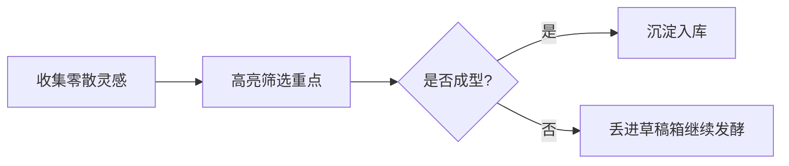

之前在 [Obsidian 入门5：别被「Markdown」吓到，它只是为了让你写得更爽](/blog/obsidian-beginner-5-markdown) 里，我和大家分享了最基础的四个排版符号。标题、粗体、列表和引用，只要记住这几样，基本就能覆盖日常绝大多数随手记录的需要。

在上一篇 [Obsidian 入门76：不习惯 Markdown？用这款插件把 Word 菜单栏搬进来](/blog/obsidian-beginner-76-editing-toolbar) 中，我们还聊了怎么借助工具栏插件，像在 Word 里划词点鼠标那样轻松加上这些格式。

不过，可能你会有另外一个疑惑：标题和加粗确实好用，但整篇笔记看下来，依然是一大片非黑即白的文字。

一段非常精辟的顿悟，一处容易踩坑的警告，一个接下来要去办的动作，全都挤在同一种密度的段落里，视觉上的轻重缓急很难一下子拉开。

想做个醒目的彩色提示框，普通引用看起来太素淡。想梳理一段业务逻辑，每次都得切到外部作图软件画好再截图贴进来，以后流程改了两个字，又得重画一遍。

其实在最基础的四个符号之外，Obsidian 还内置了一整套极其实用的进阶语法。

今天我就把日常记笔记里最常用的几套进阶语法，分成了由浅入深的三个台阶，手把手拆给你看。

---

## 第一台阶，文字的微表情

粗体就像是大声说话，但我们在记录思考的时候，有时候需要的是轻声提醒，有时候需要的是像荧光笔一样的视觉焦点。

这四个轻量级符号，就是专门用来给文字增加微表情的。

### 1. 高亮，手边那支黄色的荧光笔

这是 Obsidian 原生最让人惊喜的小扩展之一。

标准的 Markdown 语法里其实没有高亮，但在 Obsidian 里，只要在文字两边各敲两个等号，文字就会立刻被刷上一层鲜艳明亮的底色。

```text
==这是一段非常核心的认知结论==
```

日常读长文章或者摘录读书笔记时，粗体往往显得太厚重，而高亮就像是拿着一支荧光笔在书页上轻轻划过，后续扫视复习的时候，视线能第一瞬间捕捉到它。


### 2. 斜体，情绪与术语的轻声耳语

如果你想记录一段英文单词、一句书名、或者自己在正文旁边的碎碎念心声，可以用单个星号把文字包起来。

```text
*Deep Work* 是我今年反复翻看的一本书。
```

它让文字微微倾斜，既在版面上和陈述句拉开了区分，又不会像粗体那样抢夺过多注意力，特别适合作为行文间的低调注脚。


### 3. 删除线，忠实记录思考的迭代

在两边各加上两个波浪号，文字中间就会出现一条横线。

```text
~~以为这个功能只要两天就能写完~~，最后整整熬了三个通宵。
```

除了用来划掉已经过期的方案，我最喜欢在复盘或者写日记时用它。记录当初自己幼稚的想法或者自嘲的心态，删除线保留了思考的轨迹，比直接删掉文字生动得多。


### 4. 待办复选框，直接在笔记里打钩

一个横杠加空格，接着写上一对方括号，中间留一个空格，就是一个标准的待办清单。

```text
- [ ] 下午三点联系产品经理对齐接口
- [x] 上午把文章大纲整理完毕
```

它最大的乐趣在于互动。在 Obsidian 的实时预览模式下，你不需要切换到编辑代码状态，直接用鼠标点击那个小方框，它就会咔哒一声自动打上勾并变灰，打钩那一瞬间的踏实感非常解压。

有了这几个简单的微表情，一篇普通的随手草稿，立刻就有了温度和节奏。

---

## 第二台阶，结构化的高颜值容器

当你的文字不再是一句话，而是一整块需要特别突出的提醒、一份长篇参考资料、或者一段只有自己能看的备忘时，我们就需要给它们换上专门的容器。

### 1. Callout 标注盒，让重点跳出来的彩色卡片

很多朋友看到别人笔记里那些带有漂亮小图标、四周有彩色边框的提示盒，总以为装了很复杂的排版插件。

其实这是 Obsidian 原生自带的 Callout 语法，只需要在普通引用的尖括号后面，加上一对方括号指定类型。

```text
> [!note] 这是一个温和的便签
> 适合记录日常的补充说明。

> [!tip] 这是一个实用的技巧提示
> 适合放置操作小窍门。

> [!warning] 注意这里的风险
> 适合放置容易踩坑的注意事项。

> [!danger] 高危预警
> 适合标明不可逆的操作。
```

在 Obsidian 里敲完回车，这段文字就会立刻收纳进一个带有圆角和图标的彩色卡片中，专业感瞬间拉满。

它还有一个极其低调的隐藏技巧，折叠功能。只要在类型后面加上一个减号，这个标注盒默认就会收起，只有读者点一下标题时才会展开。

```text
> [!tip]- 点击展开查看详细答案与代码
> 这里是平时不想占地方的冗长细节或者排错日志。
```

做考试题自测、背诵知识点、或者把很长的代码藏在答案盒子里，这个折叠功能简直是绝配。


### 2. 脚注，长文阅读的无声降噪术

长篇笔记里经常需要注明某句话的论文出处、参考网页或者长段补充解释。如果直接插在正文括号里，阅读会被切得细碎。

这时候脚注就派上用场了。在正文需要注解的词后面打一个方括号带上尖号，然后在文章最底下给出对应说明。

```text
根据认知心理学的研究结论[^1]，人类的工作记忆容量非常有限。

[^1]: 这里是该研究论文的具体发表刊物与引用来源链接。
```

Obsidian 会自动把这个数字渲染成右上角的上标小链接。你鼠标悬停上去就能浮窗预览出处，点击还会自动跳到文末，看完点一下文末的小箭头又能一键返回正文。


### 3. 内部注释，只有你能看到的隐形便签

写文章草稿或者整理敏感数据的时候，有些话你只想留给自己看，不想在将来打印成 PDF 或者导出给别人时被发现。

只要用两对百分号把文字包起来就行。

```text
这里打算放上周测试的数据。%% 记得明天找张三核对一下真实数字 %%
```

只要你在编辑它，这行字就在屏幕上好端端待着。一旦你切换到阅读模式，或者导出为 PDF，这两对百分号以及中间的内容就会彻底隐形，连一行空隙都不会留下。


### 4. 跨笔记嵌入，让内容自由生长的乐高积木

双链不仅仅是点击跳转，它还可以把另一篇笔记里的特定段落直接搬到眼前。

在正常的双链语法前面，加一个感叹号。

```text
![[我的2026年度目标#健康生活]]
```

只要敲完这一行，另一篇笔记里关于健康生活的所有内容，就会像一块乐高积木一样，端端正正嵌在当前笔记里。源笔记里的文字改了，这里会实时同步变化，完全不需要手动到处复制粘贴。


当这些容器各司其职，你的笔记系统就从零散的草稿本，变成了结构严整的个人百科全书。

---

## 第三台阶，告别笨重截图，纯代码画出一切

如果说前面的语法还在文本修饰的范畴，那么到了这一层，Obsidian 就彻底展示出了纯文本排版的上限。

过去我们记理工科笔记或者梳理业务逻辑，最头疼的就是配图。公式要么写成乱七八糟的单行符号，要么截图。流程图每次都得去画图网站导出一张图片贴进来。

一旦过两天发现逻辑有个小漏洞，改一张图的成本比重写整段文字还要高。

在 Obsidian 里，你可以直接用键盘搞定一切。

### 1. 数学公式，理工科与学术党的优雅底气

Obsidian 深度支持 LaTeX 语法，直接内置了 MathJax 渲染引擎。

短公式直接用单美元符号`$E=mc^2$`嵌在句子中间，复杂的独立大公式用双美元符号单独占一行。

质能方程可以写成 $E = mc^2$，直接融入行文阅读。

如果遇到比较长的高斯积分公式，可以单独占一行。

$$
\int_{-\infty}^{+\infty} e^{-x^2} \, dx = \sqrt{\pi}
$$

敲完回车，凌乱的代码瞬间转变成印刷级别的专业数学符号，字迹清晰锐利，无论放大多少倍都不会失真。

### 2. Mermaid 图表，打字就是画流程图

这是许多深度知识管理玩家最迷恋的功能。

Obsidian 原生支持 Mermaid 语法。你只需要在代码块开头声明 `mermaid`，接下来用简单的文字和箭头描述逻辑，软件就会自动把它画成一张规整漂亮的矢量流程图。



这种做法最强大的地方不在于画图有多快，而在于长期的可维护性。

半年后你的业务流程变了，你根本不需要满世界找原始设计源文件。直接在笔记里把某个节点的名字改掉，或者顺手加一条新连线，整张图的排版布局会自动重新算好，重新变得整整齐齐。

除了流程图，它还支持甘特图、时序图和思维导图。

不用开画图工具，不用截图，不用担心图床挂掉或者图片被压缩变糊，纯文本的力量在这类场景下被发挥得淋漓尽致。

---

## 别想一口吃成胖子，挑一个今天能用上的开始

一口气看到这里，你可能会觉得内容有点多，脑子里开始打架。

请千万放宽心，你完全不需要在今天之内把所有符号都背下来。Markdown 本身是一套服务于表达的工具，而不是给你设置门槛的考试大纲。


我给大家最实在的建议是，先把这篇文章收藏起来，当成一份随时可以翻看的对照字典。然后在你今天准备写的下一篇笔记里，挑一个让你最心动的语法，尝试用一次。

也许是给一句重要心得涂上 ==明亮的高亮==。

也许是随手写下一个 `- [ ]` 待办清单并亲手在上面打个勾。

也许是给一个容易遗忘的注意事项套上 `> [!tip]` 的彩色卡片Callout。

用顺手了一个，再去解锁下一个。当你习惯了这些趁手的小工具，你手下的笔记就不再只是一堆沉睡的字符，而是真正成为了一套有结构、有层次、能够跟你一起生长的活系统。

---

## 今日练习挑战，给一段文字注入灵魂

你可以尝试把下面这段乱糟糟的内容复制到你的 Obsidian 里，用今天学到的进阶暗号改造它。

**练习文本**
```text
我的 Obsidian 进阶技能树

这一条一定要看，高亮显示让我一眼就能找到它。

原来以为只要背熟语法就能写好笔记，其实多写才是硬道理，把前面那句划掉。

今日待办事项
学会使用彩色提示盒
尝试用代码写一个简单的流程
给笔记加上一个参考出处

这里放一个关于数据安全的特别提示，要用黄色卡片包起来。

思考路径大概是这样的，从阅读输入，到筛选过滤，再到输出分享。

顺手写一个只有我自己能看到的备忘，明天提醒自己复盘。
```

给它加上高亮、划上删除线、做成待办复选框、套上 Callout 提示盒、写一段 Mermaid 箭头，再塞一条内部注释。

改完之后按一下 `Cmd/Ctrl + E` 切换到阅读模式。你会看到，一页原本平淡无奇的记事本，瞬间变成了让人赏心悦目的精装内页。

这就是属于纯文本的独特魅力。

---

## 进阶阅读

如果你想进一步探索排版细节、双链连接或者让笔记变得更好看，下面这几篇入门文章可以串起来一起看。

- [Obsidian 入门5：别被「Markdown」吓到，它只是为了让你写得更爽](/blog/obsidian-beginner-5-markdown)
- [Obsidian 入门76：不习惯 Markdown？用这款插件把 Word 菜单栏搬进来](/blog/obsidian-beginner-76-editing-toolbar)
- [Obsidian 入门6：必学的双向链接与元数据，真正开启第二大脑](/blog/obsidian-beginner-6-wikilink-frontmatter)
- [Obsidian 入门14：在笔记中也可以做任务管理(todo)全流程](/blog/obsidian-entry-14-task-management-workflow)
- [Obsidian 入门18：在笔记里插入一张干净的表格](/blog/obsidian-table-guide)
- [Obsidian 入门73：别人家的 Obsidian 为什么那么好看？秘密就在这篇里](/blog/obsidian-73-themes-css-customization)
